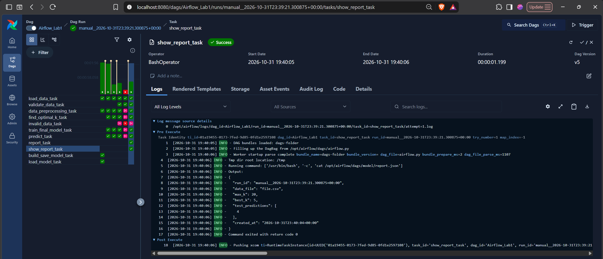
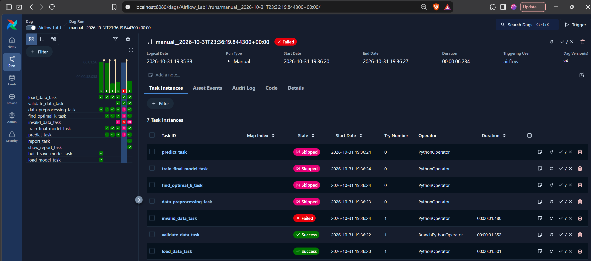
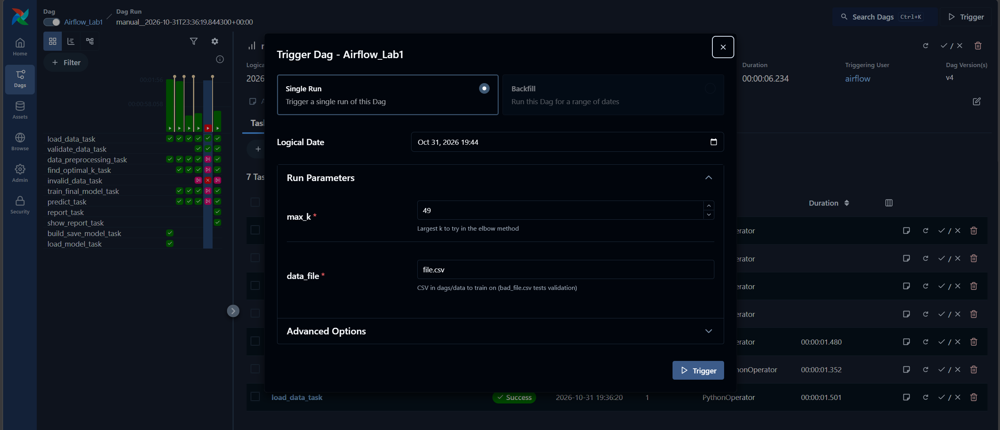

# Airflow Lab 1 - K-Means Clustering Pipeline

This is my version of Airflow Lab 1 from the MLOps course. The original DAG loads credit card customer data, tries K-Means with 1 to 49 clusters and predicts a cluster for a test customer. I fixed two bugs in the pipeline and added data validation with branching, run settings, retries and a report at the end.

Original lab: [course repo](https://github.com/raminmohammadi/MLOps/tree/main/Labs/Airflow_Labs/Lab_1)

## What to install

- Docker Desktop (I tested with Docker 29.8.0 on Windows 11). Give Docker at least 4 GB of memory, 8 GB is better.
- Git

Everything else runs inside Docker, nothing else needs to be installed:

- Airflow 3.3.2, Postgres 16 and Redis 7.2 (set in `docker-compose.yaml`)
- pandas 3.0.5, scikit-learn 1.9.1 and kneed 0.9.0 (set in `.env`, installed when the containers start)

## Setup (one time)

Make sure Docker Desktop is running, then:

Windows (PowerShell):

```
git clone https://github.com/nikhilshugar/mlops-labs.git
cd mlops-labs/airflow-lab
mkdir logs, plugins, config
docker compose up airflow-init
```

Mac/Linux:

```
git clone https://github.com/nikhilshugar/mlops-labs.git
cd mlops-labs/airflow-lab
mkdir -p logs plugins config
docker compose up airflow-init
```

On Linux, also change `AIRFLOW_UID=50000` in `.env` to the number that `id -u` prints.

The first time, this downloads the images and takes 5-10 minutes. It's done when it shows `airflow-init-1 exited with code 0`.

## How to run

Start Airflow:

```
docker compose up -d
```

Wait 2-3 minutes, then run `docker compose ps` until every service shows `(healthy)`.

Open http://localhost:8080 and log in with username `airflow` and password `airflow`.

1. On the Dags page, turn on `Airflow_Lab1` with the toggle.
2. Click Trigger. The form has two settings: `max_k` (default 49) and `data_file` (default `file.csv`). Click Trigger.
3. To test the bad data path, trigger again with `data_file` set to `bad_file.csv`.

To stop Airflow: `docker compose down`

## What a successful run looks like

- `file.csv` with `max_k` 49: all tasks on the training path are green and `invalid_data_task` is skipped. `find_optimal_k_task` logs `Optimal no. of clusters: 8` and the prediction is `[6]`.
- `file.csv` with `max_k` 20: best k is 5 and the prediction is `[4]`.
- `show_report_task` prints the report, which is also saved on your machine in `dags/model/report.json`.
- `bad_file.csv`: `invalid_data_task` fails with `Data validation failed: only 3 usable rows, need at least 100; negative values in BALANCE, PURCHASES or CREDIT_LIMIT`. The training tasks are skipped and the run shows Failed.

Good data:



Bad data:



Trigger form:



## Pipeline

```
load_data_task -> validate_data_task -> data_preprocessing_task -> find_optimal_k_task -> train_final_model_task -> predict_task -> report_task -> show_report_task
                                     -> invalid_data_task (only when the data is bad)
```

## Changes I made

1. Fixed the pipeline: the original saved the k=49 model and only printed the best k from the elbow method, and it predicted on test data that was not scaled. Now `find_optimal_k_task` returns the best k, `train_final_model_task` gets it through XCom and trains the final model with it, and `predict_task` scales `test.csv` with the scaler saved during preprocessing.
2. Run settings, retries and timeout: `max_k` can be set in the trigger form (3 to 100) using Airflow Params. Tasks retry 2 times, 30 seconds apart. `find_optimal_k_task` stops after 10 minutes.
3. Data validation with branching: `validate_data_task` (BranchPythonOperator) checks for missing columns, fewer than 100 usable rows and negative values. Good data goes to training. Bad data goes to `invalid_data_task`, which fails the run without retries, and the training tasks are skipped. Added a `data_file` setting and `bad_file.csv` to test it.
4. Report: `report_task` collects the run id, settings, best k and predictions into `dags/model/report.json`. `show_report_task` (BashOperator) prints it.
5. Setup: moved to Airflow 3.3.2 with the official `docker-compose.yaml`, turned off the example DAGs, added `.env` with pinned package versions, and removed the old Linux-only `setup.sh` and the old `airflow.cfg` (Airflow creates a new one on first start).

## If something goes wrong

- Red number next to the Dag count: click it to see the error in the DAG file.
- Services not healthy after a few minutes: check Docker Desktop has at least 4 GB of memory.
- Port 8080 already in use: stop the other program using it, or stop other running containers.