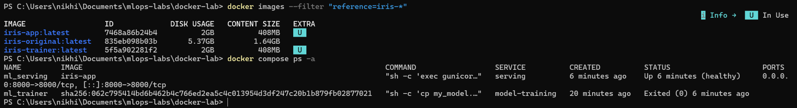
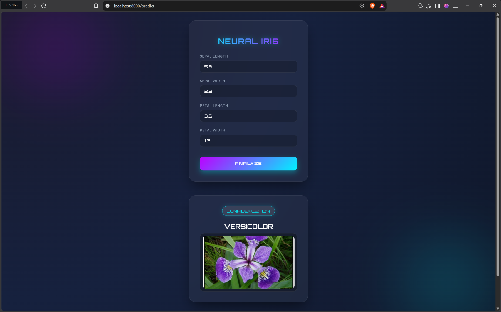
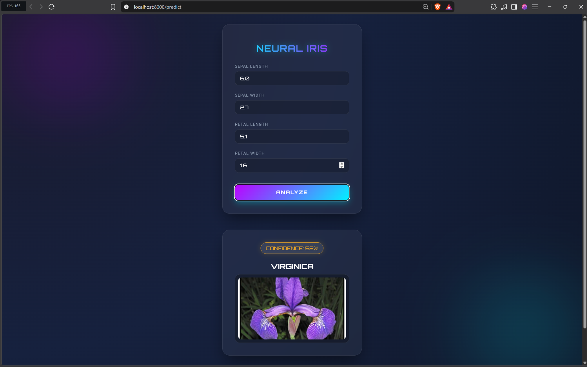

# Docker Lab 2 - Iris Classifier

This is my version of Docker Lab 2 from the MLOps course. The original lab trains a small TensorFlow model on the Iris dataset and serves it with Flask, using a two-stage dockerfile and a docker-compose file. When I ran it the page did not load, a lot of predictions were wrong and the image was 5.37 GB. I fixed these and made the image smaller and safer.

Original lab: [course repo](https://github.com/raminmohammadi/MLOps/tree/main/Labs/Docker_Labs/Lab2)

## What to install

- Docker Desktop (I tested with Docker 29.8.0 on Windows 11)
- Git

Everything else is installed inside the images:

- Python 3.10
- tensorflow-cpu 2.15.0, scikit-learn 1.7.2 and numpy 1.26.4
- Flask 3.1.3 and gunicorn 23.0.0

## Setup (one time)

Start Docker Desktop, then:

```
git clone https://github.com/nikhilshugar/mlops-labs.git
cd mlops-labs/docker-lab
```

## How to run

```
docker compose up -d --build
```

The first build downloads TensorFlow, so it can take a few minutes. After it starts, wait about 40 seconds and run `docker compose ps -a`. `ml_trainer` should show `Exited (0)` and `ml_serving` should show `(healthy)`.

Open http://localhost:8000/predict, enter the 4 measurements and click Analyze.

To stop: `docker compose down`

To run it without compose (stop compose first):

```
docker build -f dockerfile -t iris-app .
docker run -d -p 8000:8000 --name iris-app iris-app
```

To stop: `docker rm -f iris-app`

To send many flowers in one request to the batch API:

Windows (PowerShell):

```
$body = '{"flowers": [[5.1, 3.5, 1.4, 0.2], [5.6, 2.9, 3.6, 1.3], [6.3, 3.3, 6.0, 2.5]]}'
Invoke-RestMethod -Uri http://localhost:8000/api/predict -Method Post -ContentType "application/json" -Body $body | ConvertTo-Json -Depth 5
```

Mac/Linux:

```
curl -X POST http://localhost:8000/api/predict -H "Content-Type: application/json" -d '{"flowers": [[5.1, 3.5, 1.4, 0.2], [5.6, 2.9, 3.6, 1.3], [6.3, 3.3, 6.0, 2.5]]}'
```

## What a successful run looks like

- http://localhost:8000/health shows `{"status": "ok"}`.
- 5.1, 3.5, 1.4, 0.2 gives Setosa with close to 100% confidence.
- 5.6, 2.9, 3.6, 1.3 gives Versicolor with about 73%.
- 6.0, 2.7, 5.1, 1.6 gives Virginica with 52% and an amber badge. This is a borderline flower the model is unsure about.
- The batch API returns `count: 3` with Setosa (0.996), Versicolor (0.726) and Virginica (0.896).

Image sizes and containers:



Prediction:



Low confidence:



## Changes I made

1. Fixed the port: the app listened on 4000 but the dockerfile and compose used 80, so the page never loaded. Now a `PORT` setting (8000) is used by the app, the dockerfile and compose.
2. Fixed wrong predictions: the model was trained on scaled data but the app sent raw numbers, so it got only about 33% of the flowers right. The scaler is now saved with the model and the app uses it (85%). Also added a `/health` endpoint.
3. Training: added a fixed seed so every build trains the same model, and trained for 200 epochs instead of 50 (93%).
4. Smaller image: used python:3.10-slim and tensorflow-cpu, split the packages into training and serving lists with pinned versions, and installed packages before copying the code so a code change doesn't reinstall TensorFlow. Packages are downloaded once and reused. The image went from 5.37 GB to 2 GB and the first build from about 7 minutes to about 2.
5. Safer serving: gunicorn instead of the Flask debug server, the app runs as a normal user instead of root, and Docker checks `/health` to mark the container healthy.
6. Compose: both containers are now built from the dockerfile instead of installing TensorFlow every time they start. The trainer copies the model into a shared volume and the server reads it from there. If the server stops, Docker restarts it.
7. Batch endpoint: `/api/predict` predicts many flowers in one request.
8. Real confidence: the page always said "CONFIDENCE: HIGH". Now it shows the real confidence and turns amber below 60%.

## If something goes wrong

- "hashes do not match" during the build: the download got interrupted. Run the build again.
- Port 8000 already in use: stop the other container using it, for example `docker rm -f iris-app`.
- `ml_serving` shows `(health: starting)`: wait 30 seconds and check again.