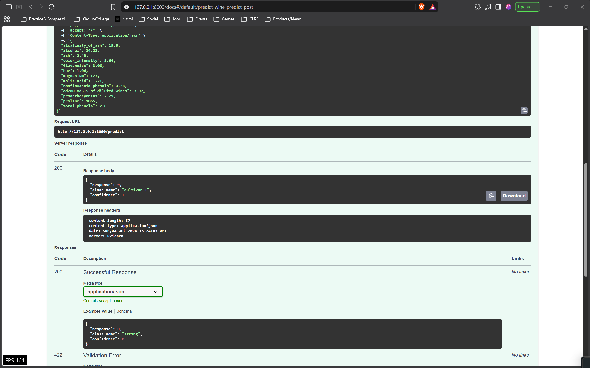
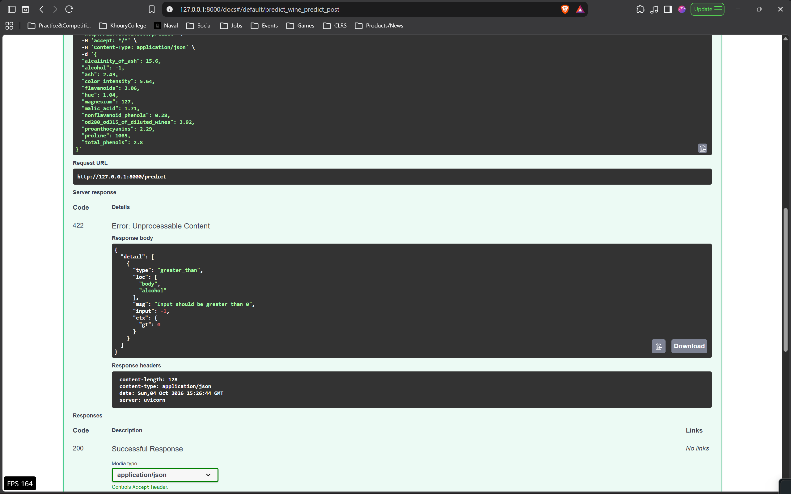

# FastAPI Lab - Wine Classifier

My version of the FastAPI lab from the MLOps course. The original lab trains a Decision Tree on the Iris dataset and serves it with FastAPI. I changed it to train a Random Forest on the Wine dataset and made a few changes to the API (listed below).

Original lab: [course repo](https://github.com/raminmohammadi/MLOps/tree/main/Labs/API_Labs/FastAPI_Labs)

## Changes from the original lab

- Dataset: Iris -> Wine (sklearn load_wine, 178 samples, 13 features, 3 classes). Train/test split is now stratified.
- Model: Decision Tree -> Random Forest (100 trees). train.py prints test accuracy.
- predict.py loads the model once at startup instead of on every request, and also returns class probabilities.
- /predict takes the 13 wine features and returns the predicted class, class name and confidence.
- Input validation: every feature must be > 0, otherwise the API returns 422.
- Added an example request so /docs is pre-filled.
- Updated requirements to versions that work on Python 3.14.

## How to run

```
python -m venv .venv
.venv\Scripts\activate            (Mac/Linux: source .venv/bin/activate)
pip install -r requirements.txt
cd src
python train.py
uvicorn main:app --reload
```

Then open http://127.0.0.1:8000/docs, expand POST /predict, click Try it out and Execute.

## Screenshots

Prediction:



Invalid input (negative alcohol):

