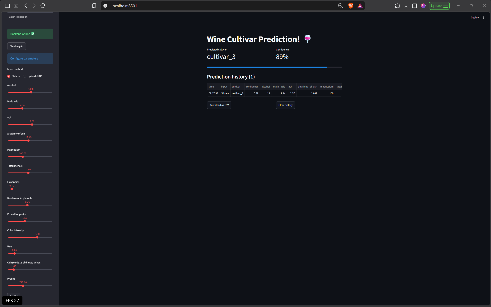
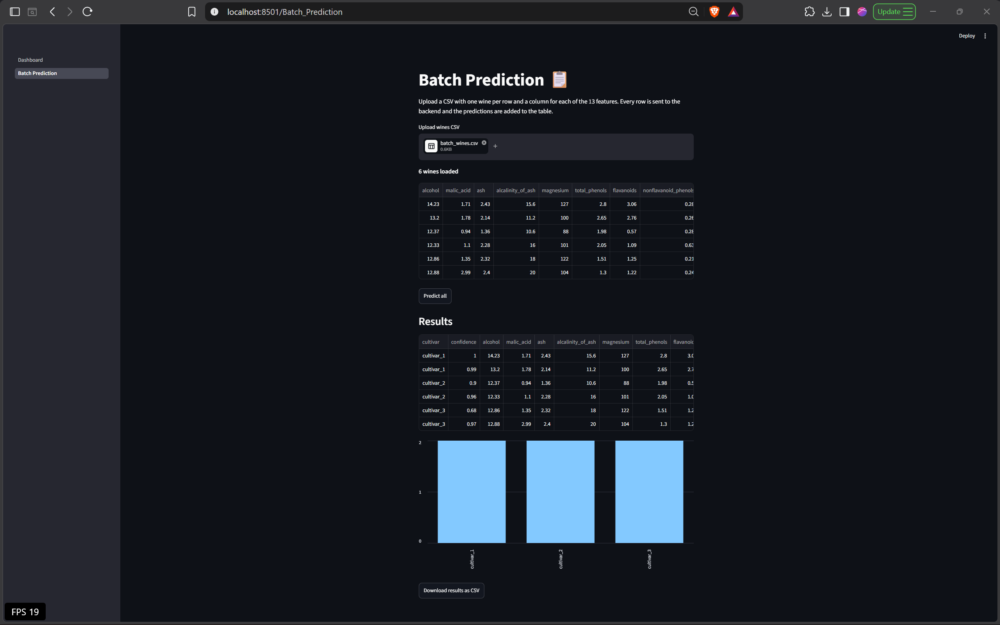
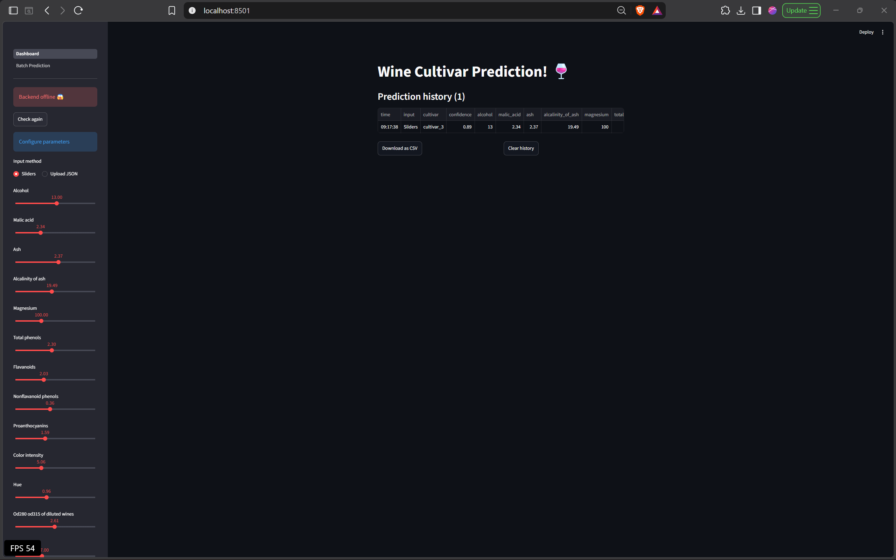

# Streamlit Lab - Wine Cultivar Dashboard

This is my version of the Streamlit lab from the MLOps course. The original lab is a dashboard for an Iris model. I changed it to use the Wine model API from my FastAPI lab (the `fastapi-lab` folder in this repo) and added new features to the dashboard.

Original lab: [course repo](https://github.com/raminmohammadi/MLOps/tree/main/Labs/API_Labs/Streamlit_Labs)

## How it works

Two programs run at the same time:

- Backend: the FastAPI app in `fastapi-lab`. It serves the Wine model at http://localhost:8000.
- Dashboard: the Streamlit app in `streamlit-lab/src`. It runs at http://localhost:8501 and sends inputs to the backend.

## What to install

- Python 3.11 or newer (I tested with 3.14.7 on Windows 11). On Windows, tick "Add python.exe to PATH" when installing.
- Git

These Python packages are installed in the setup step from `requirements.txt`:

- scikit-learn 1.9.1
- fastapi[all] 0.142.2
- streamlit 1.66.0
- requests 2.34.2
- pandas 3.0.6

## Setup (one time)

Windows:

```
git clone https://github.com/nikhilshugar/mlops-labs.git
cd mlops-labs/streamlit-lab
python -m venv .venv
.venv\Scripts\activate
pip install -r requirements.txt
```

Mac/Linux:

```
git clone https://github.com/nikhilshugar/mlops-labs.git
cd mlops-labs/streamlit-lab
python3 -m venv .venv
source .venv/bin/activate
pip install -r requirements.txt
```

The trained model is already in the repo (`fastapi-lab/model/wine_model.pkl`), so no training is needed.

## How to run

Open two terminals in `mlops-labs/streamlit-lab`.

Terminal 1 (backend), Windows:

```
.venv\Scripts\activate
cd ../fastapi-lab/src
uvicorn main:app --reload
```

Terminal 1 (backend), Mac/Linux:

```
source .venv/bin/activate
cd ../fastapi-lab/src
uvicorn main:app --reload
```

Wait until it says `Application startup complete`.

Terminal 2 (dashboard), Windows:

```
.venv\Scripts\activate
cd src
streamlit run Dashboard.py
```

Terminal 2 (dashboard), Mac/Linux:

```
source .venv/bin/activate
cd src
streamlit run Dashboard.py
```

If Streamlit asks for an email, press Enter. The dashboard opens at http://localhost:8501.

## What a successful run looks like

- The sidebar shows "Backend online".
- Predict with the default sliders: cultivar_2, about 43% confidence, with a low confidence warning.
- Upload `data/test.json` in Upload JSON mode: cultivar_1, 100%.
- Batch Prediction page with `data/batch_wines.csv`: 2 wines of each cultivar.
- If you stop the backend and click Check again: "Backend offline", and Predict is disabled.

Dashboard:



Batch Prediction page:



Backend stopped:



## Changes I made

1. Wine model and input choice: the dashboard now uses my Wine API. You pick either sliders or a JSON file, instead of both showing at once. The 13 sliders get their ranges from the Wine dataset. A bad JSON file shows an error instead of crashing. I removed the check for `iris_model.pkl`, which blocked every prediction.
2. Health check: fixed a bug where a warning and a success box showed together. Timeouts no longer crash the app. The check is cached for 30 seconds instead of running on every slider move, and there is a Check again button. Predict is disabled when the backend is offline.
3. Result display: shows the predicted cultivar and confidence as metric cards with a progress bar, and a warning when confidence is below 60%.
4. Prediction history: every prediction is saved in `st.session_state` and shown in a table. You can download it as CSV or clear it.
5. Batch Prediction page: a new page using Streamlit's multipage feature. Upload a CSV of wines and it predicts every row, shows a table and a bar chart, and lets you download the results.
6. Other: updated requirements.txt to versions that work on Python 3.14, replaced test.json with a wine sample, and replaced the old screenshots.

## If something goes wrong

- "Backend offline": start the backend first, then click Check again.
- `Could not import module "main"`: run uvicorn from `fastapi-lab/src`.
- `streamlit` or `uvicorn` not recognized: activate the virtual environment in that terminal.
- Windows PowerShell says scripts are disabled: run `Set-ExecutionPolicy -Scope CurrentUser RemoteSigned`, then activate again.